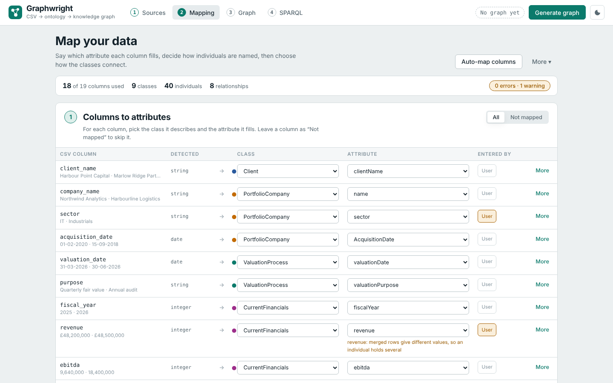
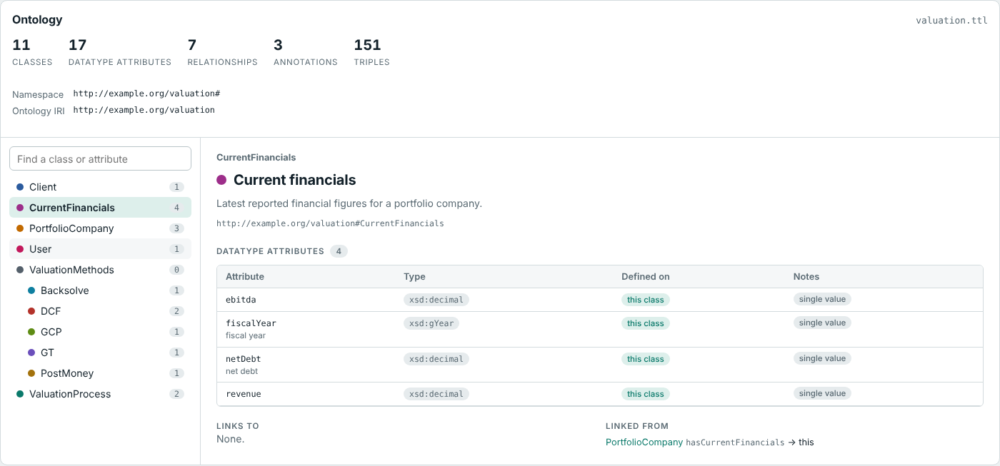
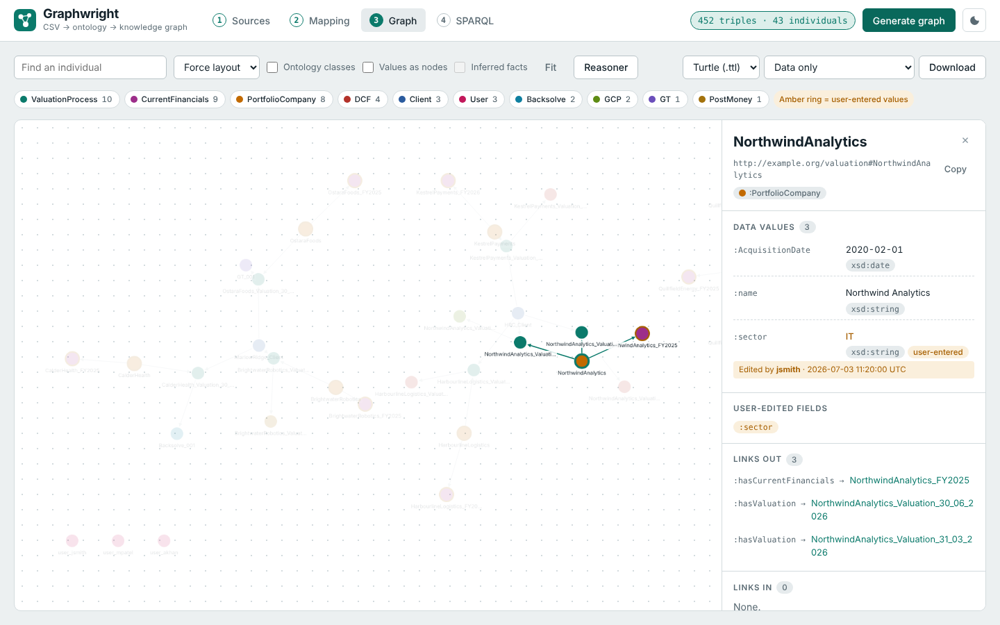
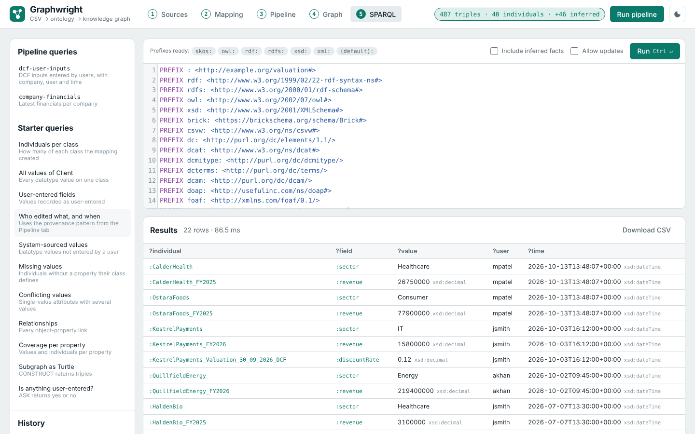
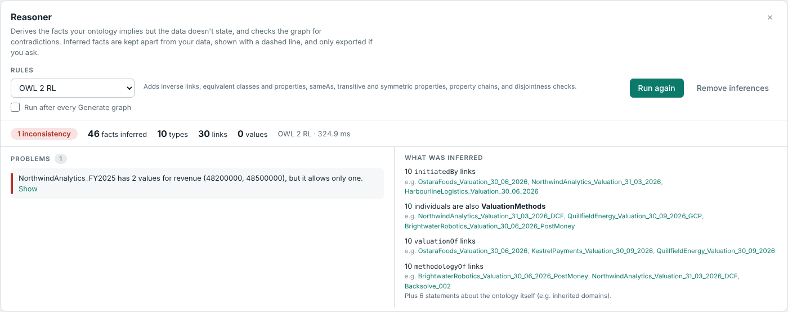

# Graphwright

**Turn a CSV file into a knowledge graph that follows your OWL ontology, without writing code.**

Graphwright is a local web app. You load an ontology (`.ttl`) and a data file (`.csv`), choose which column fills which attribute, decide how each individual gets its name, and generate an RDF knowledge graph. You can then explore the graph visually, run a reasoner over it, query it with SPARQL and export it.

It also tracks **which values were entered by a user**: who entered them and when. This makes it a good basis for provenance and anomaly-detection work.



---

## Contents

1. [Features](#features)
2. [Requirements](#requirements)
3. [Installation](#installation)
4. [Quick start (5 minutes)](#quick-start-5-minutes)
5. [Step-by-step guide](#step-by-step-guide)
   - [Step 1: Sources](#step-1-sources)
   - [Step 2: Mapping](#step-2-mapping)
   - [Step 3: Graph](#step-3-graph)
   - [Step 4: SPARQL](#step-4-sparql)
6. [Naming individuals](#naming-individuals)
7. [Values, datatypes and formats](#values-datatypes-and-formats)
8. [User-entered values (provenance)](#user-entered-values-provenance)
9. [Reasoner](#reasoner)
10. [Mapping files](#mapping-files)
11. [Preparing your own files](#preparing-your-own-files)
12. [Limits](#limits)
13. [Troubleshooting](#troubleshooting)
14. [HTTP API](#http-api)
15. [Project structure](#project-structure)
16. [Credits](#credits)

---

## Features

| Area | What you get |
|---|---|
| **Ontology explorer** | Browse every class in its hierarchy and see its datatype attributes, both its own and inherited, with their types. You also see the relationships to and from each class and its subclasses. |
| **Column mapping** | Map each CSV column to a class and an attribute in a simple table. **Auto-map** fills it in from column names. |
| **Instance naming** | Name individuals by running number, from a column, with a pattern, from a list you paste, or a list with a pattern fallback. Names can be built from linked individuals, e.g. `NorthwindAnalytics_FY2025`. |
| **Relationships** | The ontology's object properties are offered as checkboxes. Individuals from the same row are linked automatically. |
| **Live checks** | Errors and warnings appear as you map: broken patterns, values that don't fit their type, domain mismatches, conflicting values. |
| **Provenance** | Mark columns as user-entered. The graph records `:userEdited`, plus who (`:editedBy`) and when (`:editedAt`). |
| **Interactive graph** | Click any node to see its types, values, datatypes, edit history, links and source CSV rows. Search, filter by class, switch layouts. |
| **Reasoner** | RDFS / OWL 2 RL reasoning. It infers types and inverse links and finds contradictions, such as disjoint classes or two values for a single-value attribute. |
| **SPARQL** | Full SPARQL 1.1 editor with ready-made queries, query history and CSV download. Updates are optional. |
| **Export** | Turtle, JSON-LD, N-Triples or RDF/XML: data only, with the ontology and/or with inferences. |
| **Reusable mappings** | Save a mapping as a short, readable JSON file and re-apply it to next month's CSV. |

---

## Requirements

- **Python 3.10 or newer**
- A modern browser (Chrome, Edge, Firefox or Safari)
- No database, Java or Node.js needed. The front-end libraries are bundled in the repo.

---

## Installation

```bash
# 1. Get the code
git clone https://github.com/MuhammadAbdullah10/GraphWright graphwright
cd graphwright

# 2. Create a virtual environment (recommended)
python -m venv .venv
source .venv/bin/activate        # Windows: .venv\Scripts\activate

# 3. Install dependencies
pip install -r requirements.txt

# 4. Start the app
python run.py
```

Your browser opens at **http://localhost:8000**. Stop the server with `Ctrl+C`.

### Start-up options

| Command | What it does |
|---|---|
| `python run.py` | Start on port 8000 and open the browser |
| `python run.py --port 8080` | Use a different port |
| `python run.py --no-browser` | Don't open a browser tab |
| `python run.py --host 0.0.0.0` | Allow other machines on your network to connect (see the [note on security](#limits)) |

You can also start the server with uvicorn directly: `uvicorn app.main:app --port 8000`.

---

## Quick start (5 minutes)

The repo includes a complete example from the valuation domain, so you can see every feature before using your own files.

1. Start the app and press **Load the valuation sample** on the first screen.
   This loads an ontology (Client, ValuationProcess, PortfolioCompany, CurrentFinancials, and the valuation methods DCF, GCP, GT, Backsolve and PostMoney), a 10-row CSV and a finished mapping.
2. You land on **Mapping**. Scroll through the three steps to see how each column is mapped, how individuals are named and which relationships are switched on.
3. Press **Generate graph** (top right). The **Graph** tab opens.
4. Click **NorthwindAnalytics** in the graph. The panel on the right shows its values. `sector` is marked *user-entered* with who entered it and when.
5. Press **Reasoner → Run reasoner**. It infers 46 new facts and reports one problem: Northwind's FY2025 revenue has two different values. This conflict is planted in the sample data.
6. Open **SPARQL** and click **Who edited what, and when** to see every user-entered value with its author and timestamp.
7. Back on **Graph**, choose a format and press **Download** to save the knowledge graph.

---

## Step-by-step guide

The tabs along the top follow the workflow: **1 Sources → 2 Mapping → 3 Graph → 4 SPARQL**. A number turns green once that step is done. The pill next to **Generate graph** shows the size of the current graph, or says *Mapping changed · regenerate* when the graph is out of date.

### Step 1: Sources

Drop your files onto the two boxes, or click a box to browse.

| Box | Accepted files |
|---|---|
| **Ontology** | Turtle `.ttl` (preferred), RDF/XML `.owl` / `.rdf`, N-Triples `.nt`, N3, JSON-LD |
| **Data** | `.csv`, `.tsv` or `.txt`. The first row must be the header. Comma, semicolon, tab and pipe delimiters are detected automatically. UTF-8, Windows-1252 and Latin-1 encodings are handled. |

Once loaded you see two panels.

**Ontology explorer.** Totals for classes, datatype attributes, relationships and annotations, then:

- **Left:** the class hierarchy. The number next to each class is how many datatype attributes it has, including inherited ones. The search box finds classes *and* attributes; typing `revenue` shows CurrentFinancials.
- **Right:** the selected class:
  - its **datatype attributes** with their type (e.g. `xsd:decimal`) and whether each is defined on this class or *inherited from* a parent
  - **Links to / Linked from**: the object properties that connect it to other classes
  - its **subclasses**

  Every class name is clickable.



**Data.** Row and column counts, then a profile of each column (detected type, how full it is, number of distinct values, examples) and the first 25 rows.

### Step 2: Mapping

The mapping page has three steps. The bar at the top keeps a running count of columns used, classes, individuals and relationships. The pill on its right shows the checks; click it to see the full list.

> **Shortcut:** press **Auto-map columns**. It matches column names to attribute names (`company_name` → `name` on PortfolioCompany), adds the classes and switches on the relationships. Review the result rather than trusting it blindly.

#### 1 · Columns to attributes

One row per CSV column.

1. **Class:** pick the class the column describes. *Classes in this mapping* are ones already in use. *Add a class* adds a new one. Leave **Not mapped** to skip the column.
2. **Attribute:** pick the attribute the column fills. The list shows the chosen class's attributes first, including inherited ones, then general ones like `rdfs:label`.
3. **User:** tick it if the values in this column were typed in by a person rather than coming from a system. See [provenance](#user-entered-values-provenance).
4. **More:** opens extra settings for the row:
   - **Datatype:** taken from the attribute's range in the ontology. Override it here if needed.
   - **Date format / Percentages / Language tag:** depends on the datatype (see [Values, datatypes and formats](#values-datatypes-and-formats)).
   - **Map it to another class too:** use the same column for a second attribute.
   - **Remove this mapping**

Use the **All / Not mapped** switch to focus on columns you haven't dealt with yet. Problems, such as a value that isn't a valid date, appear in red or amber under the row they belong to.

#### 2 · Name the individuals

One row per class. Choose **how names are made**. The preview on the right shows the first names and the number of individuals as you type. The four methods are explained in [Naming individuals](#naming-individuals).

**More options** on each row:

| Option | Meaning |
|---|---|
| Display name | The name shown in the app, e.g. "Portfolio company" |
| How many individuals | **One per row** (default) or **One for the whole file** |
| Same name appears again | **Treat as the same individual** (merge rows), **Make it unique** (`_2`, `_3`) or **Report an error** |
| Name style | For *From a column*: as written, joined (`NorthwindAnalytics`) or lower case |
| Rows not in the list | For *Name list*: give them a numbered name or use a pattern |
| Name value is empty | Use a numbered name instead, or skip the row |
| Only create an individual when the row has a value… | When ticked (default), rows with no data for this class are skipped. Useful for sparse columns such as DCF inputs, which only exist on DCF rows. |
| Fixed values | An attribute set to the same value on every individual, e.g. `currency = GBP` |
| Remove … from the mapping | Delete the class and its relationships |

**Add class** (under the list) adds a class that has no columns of its own, for example a process that only connects other individuals.

#### 3 · Connect the classes

The relationships your ontology allows between the mapped classes appear as checkboxes, each with the number of links it will create. A ticked relationship links the individuals **that come from the same CSV row**.

When exactly one relationship fits a pair of classes, it is ticked automatically. **Add a relationship that isn't listed** lets you add any object property between any two classes.

#### The More ▾ menu

| Item | Purpose |
|---|---|
| Output settings | Namespace for individuals, the `:userEdited` property, and where "who" and "when" come from |
| Import mapping… | Load a saved mapping file |
| Export mapping | Save the mapping in the short, readable format |
| Export full mapping (all fields) | Save the expanded format the engine uses |
| Clear mapping | Start again; Output settings are kept |

When the mapping is ready, press **Generate graph**. If there are errors, the app stays on the mapping page and lists them.

### Step 3: Graph



**Reading the graph**

- Each circle is an individual, coloured by class. The legend above the graph shows each class and its count; click one to hide or show it.
- An **amber ring** means the individual holds at least one user-entered value.
- **Solid arrows** are relationships from your data. **Dashed blue arrows** are relationships inferred by the reasoner.

**Interacting**

| Action | Result |
|---|---|
| Click a node | Highlights it and its neighbours, and opens the details panel |
| Double-click a node | Zooms to its neighbourhood |
| Click empty space | Clears the highlight |
| Type in **Find an individual**, then press Enter | Highlights matches and opens the first one |
| **Fit** | Shows the whole graph |
| Scroll / drag | Zoom / pan; drag nodes to rearrange |

**Toolbar options**

| Option | Effect |
|---|---|
| Layout | Force (default), Hierarchy, Concentric, Circle or Grid |
| Ontology classes | Also draw the classes and `rdf:type` / `rdfs:subClassOf` edges |
| Values as nodes | Draw each data value as a small box attached to its individual |
| Inferred facts | Show the reasoner's inferences (available after running it) |
| Reasoner | Opens the [reasoner panel](#reasoner) |

**The details panel** shows, for the clicked individual:

- its IRI (with a **Copy** button) and its classes
- **Data values:** each attribute, value and datatype; user-entered values are amber, with *Edited by … · date*; inferred values are labelled *inferred*
- **User-edited fields**
- **Links out / Links in:** click any to jump to that individual
- **Metadata:** which mapping class created it, how it was named, and which CSV rows it came from
- **Query in SPARQL:** opens a query for everything about this individual

Click a class node (with *Ontology classes* on) to see its parents, children, attributes and individuals.

**Exporting**

Choose a format and what to include, then press **Download**.

| Format | File |
|---|---|
| Turtle | `.ttl` |
| JSON-LD | `.jsonld` |
| N-Triples | `.nt` |
| RDF/XML | `.rdf` |

| Contents | Includes |
|---|---|
| Data only | The triples generated from your CSV |
| Data + ontology | Plus the ontology itself |
| Data + inferred | Your data plus reasoner inferences |
| Data + ontology + inferred | Everything |

### Step 4: SPARQL



- Write a query in the editor and press **Run** or **Ctrl+Enter** (⌘+Enter on Mac).
- **Starter queries** on the left are adapted to your ontology. Click one to load and run it:

  | Query | Answers |
  |---|---|
  | Individuals per class | How many of each class were created |
  | All values of … | Every value on one class |
  | User-entered fields | Values flagged with `:userEdited` |
  | Who edited what, and when | User-entered values with author and timestamp |
  | System-sourced values | Values *not* entered by a user |
  | Missing values | Individuals lacking an attribute their class defines |
  | Conflicting values | Single-value attributes holding more than one value |
  | Relationships | Every link between individuals |
  | Coverage per property | Values and individuals per attribute |
  | Subgraph as Turtle | A `CONSTRUCT` example |
  | Is anything user-entered? | An `ASK` example |
  | Update: flag a field as user-edited | An `INSERT` example |

- **History** keeps your last 15 queries in this browser.
- The **Prefixes ready** line shows the prefixes from your ontology. Declare the ones you use with `PREFIX` lines, as in the starter queries.
- Results support `SELECT` (table), `ASK` (yes/no) and `CONSTRUCT` / `DESCRIBE` (Turtle). Click any IRI in a result to open it in the graph. **Download CSV** saves a result table.
- **Include inferred facts:** query the graph together with the reasoner's inferences.
- **Allow updates:** required before running `INSERT`, `DELETE` and other update queries. Updates change the in-memory graph only; pressing **Generate graph** rebuilds it from the mapping and discards them.

Example: all user-entered DCF inputs, with company, author and time:

```sparql
PREFIX :    <http://example.org/valuation#>
PREFIX owl: <http://www.w3.org/2002/07/owl#>

SELECT ?company ?dcf ?field ?value ?editedBy ?editedAt WHERE {
  ?dcf a :DCF ;
       :userEdited ?field ;
       ?field ?value .
  OPTIONAL {
    ?ax owl:annotatedSource ?dcf ;
        owl:annotatedProperty :userEdited ;
        owl:annotatedTarget ?field ;
        :editedBy ?user ;
        :editedAt ?editedAt .
    OPTIONAL { ?user :userId ?editedBy }
  }
  OPTIONAL {
    ?valuation :hasMethodology ?dcf .
    ?c :hasValuation ?valuation ; :name ?company .
  }
}
ORDER BY ?company ?field
```

---

## Naming individuals

Every individual needs a name, which becomes the last part of its IRI (`http://example.org/valuation#NorthwindAnalytics`). Graphwright offers four methods per class:

| Method | Example result | Use when |
|---|---|---|
| **Numbered** | `DCF_1`, `DCF_2`… (or `DCF_001` with padding) | There's no natural name |
| **From a column** | `Northwind_Analytics` | A column holds a unique name or ID |
| **Pattern** | `NorthwindAnalytics_FY2025` | The name combines several values |
| **Name list** | `ABC_Company` | You have specific names to assign |

### Patterns

A pattern is text with `{tokens}` in it. Use the **Insert…** menu next to the pattern box to add tokens without typing them.

| Token | Replaced by |
|---|---|
| `{column_name}` | The value of that column in the current row |
| `{@node:<id>}` | The name of another class's individual **from the same row**. `<id>` is shown in *More options* and in the mapping file, e.g. `{@node:company}`. |
| `{@class}` | The class name, e.g. `CurrentFinancials` |
| `{@n}` | A running number: 1, 2, 3… |
| `{@n:3}` | A running number padded to 3 digits: 001, 002… |
| `{@row}` | The CSV row number |
| `{@today}` | Today's date, `YYYY-MM-DD` |

Add **modifiers** after a `|`, and chain them if needed (`{name|slug|lower}`). Spaces are always turned into `_` at the end:

| Modifier | `Northwind Analytics` becomes |
|---|---|
| `\|pascal` | `NorthwindAnalytics` |
| `\|camel` | `northwindAnalytics` |
| `\|slug` | `Northwind_Analytics` |
| `\|lower` | `northwind_analytics` |
| `\|upper` | `NORTHWIND_ANALYTICS` |
| `\|initials` | `NA` |
| `\|hash` | `1abb2085` (a short hash that is the same every run) |

Examples from the sample:

```
{company_name|pascal}                              → NorthwindAnalytics
{@node:company}_FY{fiscal_year}                    → NorthwindAnalytics_FY2025
{@node:company}_Valuation_{valuation_date|slug}    → NorthwindAnalytics_Valuation_31_03_2026
{@node:valuation}_DCF                              → NorthwindAnalytics_Valuation_31_03_2026_DCF
```

### Name lists

Paste one name per line. Choose how the names are matched to rows:

- **By row order:** line 1 names the first row that has data for this class, line 2 the second, and so on.
- **By key column:** write `key => name` lines. The key is matched against a column you choose. Separators `=>`, comma, tab and semicolon all work, so you can paste straight from a spreadsheet.

  ```
  Harbour Point Capital => HPC_Client
  Marlow Ridge Partners => MarlowRidge_Client
  ```

Rows that aren't in the list get a numbered name, or a name from a pattern if you choose *Use a pattern* under *Rows not in the list*.

### How names are cleaned and de-duplicated

- Names are converted into valid IRI names: accents are removed, spaces become `_`, and any characters other than letters, digits, `_`, `-` and `.` are dropped. The Checks list tells you when this happens.
- When two rows produce **the same name**, the default is to treat them as **one individual**, merging their values. That is how 10 rows become 8 companies in the sample. Change it under *More options → Same name appears again*.
- If merged rows give **different values** for the same attribute, the individual keeps both, and the Checks list warns you.

> **Tip:** for data you re-import regularly, build names from stable columns (IDs, names, dates) rather than `{@n}` or `{@row}`. Row-based names change when the CSV is re-sorted, which breaks links to the graph from other systems.

---

## Values, datatypes and formats

Each attribute's datatype comes from its `rdfs:range` in the ontology. You can override it under **More** in the column table. Supported types: `xsd:string`, `xsd:integer`, `xsd:decimal`, `xsd:double`, `xsd:boolean`, `xsd:date`, `xsd:dateTime`, `xsd:gYear`, `xsd:anyURI`.

| Type | Accepted CSV values | Stored as |
|---|---|---|
| Numbers | `1200`, `1,200`, `£48,200,000`, `$5.2`, `€10`, `(1,250,000)` (negative) | `48200000`, `-1250000` |
| Percentages | `11.5%`; choose **Keep as written** → `11.5` or **Convert to fraction** → `0.115` | decimal |
| Dates | Pick the format under **More**: Auto (day first), Auto (month first), `YYYY-MM-DD`, `DD-MM-YYYY`, `MM-DD-YYYY`, `DD/MM/YYYY`, `MM/DD/YYYY`, `DD.MM.YYYY`, `YYYY/MM/DD`, `YYYYMMDD`, `1 Feb 2020` | `2020-02-01` |
| Date-times | ISO (`2026-07-03T11:20:00Z`) and common `date time` forms | `xsd:dateTime` |
| Booleans | `true/false`, `yes/no`, `y/n`, `1/0`, `t/f` | `true` / `false` |
| Years | `2025`, `FY2025` | `xsd:gYear` |
| Text | Anything; optional language tag (e.g. `en`) | string or language-tagged string |

Empty cells produce no triple. A value that can't be converted, such as `abc` in a date column, is skipped, and the Checks list reports how many and in which rows.

---

## User-entered values (provenance)

Tick **User** on any column whose values were typed in by a person. Your existing triples stay exactly as they are; the provenance is **added** alongside them:

```turtle
:NorthwindAnalytics a :PortfolioCompany ;
    :name   "Northwind Analytics" ;
    :sector "IT" ;
    :userEdited :sector .                  # this field was entered by a user

[] a owl:Axiom ;                           # who and when, for that statement
    owl:annotatedSource   :NorthwindAnalytics ;
    owl:annotatedProperty :userEdited ;
    owl:annotatedTarget   :sector ;
    :editedBy :user_jsmith ;
    :editedAt "2026-07-03T11:20:00Z"^^xsd:dateTime .

:user_jsmith a :User ;
    :userId "jsmith" .
```

Configure it under **More ▾ → Output settings**:

| Setting | Options |
|---|---|
| Namespace for individuals | Default: the ontology's namespace |
| User-edited annotation property | Default: `<ontology namespace>userEdited` |
| Who entered the values | **Same user for all** (type a name) or **From a column** (e.g. `entered_by`) |
| When they were entered | **Time the graph is generated** or **From a column** (e.g. `entered_at`) |
| Record who and when as `owl:Axiom` annotations | Untick to write only the `:userEdited` triples |

If your ontology doesn't declare `:userEdited`, `:editedBy`, `:editedAt` or `:User`, the declarations are added to the output.

---

## Reasoner



The reasoner derives facts your ontology implies but your data doesn't state, and checks the graph for contradictions. Open it with **Reasoner** on the Graph tab.

1. Choose the **rules**:

   | Rules | Adds | Speed |
   |---|---|---|
   | **RDFS** | Superclass types (a DCF individual is also a ValuationMethods), types from property domains and ranges | Fastest |
   | **OWL 2 RL** (default) | The above plus inverse links (`owl:inverseOf`), equivalent classes and properties, `owl:sameAs`, transitive and symmetric properties, property chains | Medium |
   | **RDFS + OWL 2 RL** | Both rule sets | Slowest |

2. Press **Run reasoner**. The panel shows:
   - **Consistent** or the number of problems found
   - how many facts were inferred, split into types, links and values
   - **Problems**, each with a **Show** link to the individual
   - **What was inferred**, grouped, with examples

3. Tick **Run after every Generate graph** to make reasoning part of each run.

**Inferred facts never mix with your data silently.** They are drawn as dashed edges and labelled *inferred*. They are only included in queries when **Include inferred facts** is ticked, and only in exports when you choose an *inferred* option. **Remove inferences** discards them. They are also discarded when the graph is regenerated or changed by a SPARQL update.

**Problems the reasoner reports**

| Problem | Example |
|---|---|
| Disjoint classes | An individual is both `:Client` and `:PortfolioCompany`, which are declared `owl:disjointWith` |
| Too many values | `:revenue` is an `owl:FunctionalProperty` but has 48,200,000 and 48,500,000 |
| Wrong datatype | A value of `xsd:string` on a property whose range is `xsd:date` |
| Value on a relationship | An object property holding plain text instead of a link |

To use these checks, declare the axioms in your ontology:

```turtle
:revenue a owl:DatatypeProperty , owl:FunctionalProperty .     # one value only
:Client owl:disjointWith :PortfolioCompany .                    # can't be both
[] a owl:AllDisjointClasses ; owl:members ( :DCF :GCP :GT ) .   # pairwise disjoint
:valuationOf owl:inverseOf :hasValuation .                      # reverse link inferred
```

> OWL 2 RL is a rule-based subset of OWL 2. It handles the constructs above, but it doesn't derive everything a full reasoner such as HermiT or Pellet would, for example some conclusions from existential restrictions (`owl:someValuesFrom`).

---

## Mapping files

A mapping can be saved, put under version control and re-applied to a new CSV with the same columns. **More ▾ → Export mapping** writes a short, readable file, and **Import mapping…** loads it.

### Compact format

```json
{
  "provenance": { "editedBy": "column:entered_by", "editedAt": "column:entered_at" },
  "reasoner": "owlrl",
  "classes": {
    "company": {
      "class": ":PortfolioCompany",
      "name": "{company_name|pascal}",
      "columns": {
        "company_name": ":name",
        "sector": { "attr": ":sector", "user": true },
        "acquisition_date": { "attr": ":AcquisitionDate", "format": "dd-mm-yyyy" }
      }
    },
    "financials": {
      "class": ":CurrentFinancials",
      "name": "{@node:company}_FY{fiscal_year}",
      "columns": {
        "fiscal_year": ":fiscalYear",
        "revenue": { "attr": ":revenue", "user": true }
      }
    },
    "client": {
      "class": ":Client",
      "name": "{client_name|pascal}",
      "names": { "Harbour Point Capital": "HPC_Client" },
      "namesKey": "client_name",
      "columns": { "client_name": ":clientName" }
    }
  },
  "links": [
    "company :hasCurrentFinancials financials"
  ]
}
```

**Top-level keys**

| Key | Meaning | Default |
|---|---|---|
| `classes` | One entry per class to create individuals for. The key (e.g. `company`) is the id used in `{@node:…}` and `links`. | required |
| `links` | Relationships, written as `"from :property to"` | none |
| `provenance.editedBy` | `"column:<name>"` or a fixed user name | none |
| `provenance.editedAt` | `"column:<name>"`; otherwise the generation time | generation time |
| `provenance.axioms` | `false` to skip the `owl:Axiom` annotations | `true` |
| `reasoner` | `"rdfs"`, `"owlrl"` or `"rdfs-owlrl"`: run it after every generate | not run |
| `individuals` | Namespace for individuals | ontology namespace |
| `userEdited` | The user-edited property | `:userEdited` |

**Class keys**

| Key | Meaning | Default |
|---|---|---|
| `class` | The class: `:Local`, `prefix:Local` or a full IRI | required |
| `label` | Display name in the app | the class's `rdfs:label` |
| `name` | Naming pattern. `"GT_{@n:3}"` gives numbered names | `<Class>_{@n}` |
| `names` | Name list: an array (row order) or an object `{ "key value": "Name" }` | none |
| `namesKey` | Column the `names` object's keys are matched against | none |
| `columns` | `"csv_column": ":attribute"`, or an object (see below) | none |
| `fixed` | `{ ":attribute": "value" }`, the same on every individual | none |
| `onePer` | `"row"` or `"file"` | `"row"` |
| `duplicates` | `"merge"`, `"suffix"` or `"error"` | `"merge"` |
| `ifEmpty` | `"numbered"` or `"skip"` when the pattern has empty values | `"numbered"` |
| `onlyWithData` | Only create an individual when the row has data in its columns | `true` |

**Column object keys**

| Key | Meaning | Default |
|---|---|---|
| `attr` | The attribute, e.g. `":revenue"` | required |
| `user` | Values are user-entered | `false` |
| `type` | Datatype override, e.g. `"xsd:decimal"` | the attribute's range |
| `format` | A date format (see [formats](#values-datatypes-and-formats), e.g. `"dd-mm-yyyy"`), or `"percent-fraction"` | `auto-dmy` for dates |
| `lang` | Language tag for text | none |

Prefixes such as `xsd:` or your own are resolved from the ontology, and `:` means the ontology's default namespace.

**Export full mapping** writes the expanded form, with every field spelled out. Import accepts both formats. `app/sample/mapping.json` is an example of the full format.

---

## Preparing your own files

### Ontology checklist

- Declare classes as `owl:Class` (or `rdfs:Class`) and the hierarchy with `rdfs:subClassOf`.
- Declare attributes as `owl:DatatypeProperty` with an `rdfs:domain` (the class) and an `rdfs:range` (an `xsd:` type). The domain decides which class an attribute appears under, and the range sets its datatype.
- Declare relationships as `owl:ObjectProperty` with `rdfs:domain` and `rdfs:range`. This is how they are offered in step 3 of the mapping.
- `rdfs:label` and `rdfs:comment` are shown in the app when present.
- Set a default prefix (`@prefix : <…#> .`) so names display as `:Class`.
- Optional, for the reasoner: `owl:inverseOf`, `owl:FunctionalProperty`, `owl:disjointWith`.

### CSV checklist

- One header row with a unique name per column. Duplicate headers get `_2`, `_3`.
- One record per row. A row can describe several classes at once (a company, its financials and a valuation), and the relationships in step 3 link them.
- Use consistent date and number formats within a column.
- If you track provenance, add columns for who entered the data and when (e.g. `entered_by`, `entered_at`).

---

## Limits

| Limit | Value |
|---|---|
| Rows used for the live mapping preview | first 2,000 (Generate uses all rows) |
| Individuals drawn in the graph view | first 2,500 (all are in the graph and queryable) |
| Rows displayed for a SPARQL `SELECT` | first 5,000 (the full count is shown) |

- **Sessions are held in memory.** Restarting the server clears the loaded files and the graph. Export your mapping and graph to keep them.
- **One session per server.** Everyone who opens the same server shares one workspace. This is a single-user desktop tool.
- **No authentication.** By default the server only listens on `127.0.0.1`. Only use `--host 0.0.0.0` on a network you trust.
- The graph and the reasoner run in memory with rdflib. They work comfortably for tens of thousands of rows, and get slower beyond that.

---

## Troubleshooting

| Symptom | Fix |
|---|---|
| `Address already in use` on start | Another program uses port 8000. Run `python run.py --port 8080`. |
| "No classes were found in this file" | The ontology must declare `owl:Class` / `rdfs:Class` or use `rdfs:subClassOf`. Check that the file extension matches its syntax. |
| "Could not parse …" | The ontology has a syntax error. Open it in Protégé or a Turtle validator to find the line. |
| A column's values are skipped as "not a date" | Open **More** on that row and choose the date format the CSV actually uses. |
| An attribute doesn't appear in the dropdown for a class | Its `rdfs:domain` is another class. Look under *Attributes of other classes*, or fix the domain in the ontology. |
| Fewer individuals than rows | Rows with the same name are merged (by design), or rows without data for that class are skipped. See the preview counts. |
| Names like `PortfolioCompany_7` appear unexpectedly | The pattern had an empty value in that row, so a numbered name was used. Choose *Skip that row* under *Name value is empty*, or fill the data. |
| No relationships offered in step 3 | The ontology's object properties need `rdfs:domain` and `rdfs:range` matching your classes. Use *Add a relationship that isn't listed* otherwise. |
| SPARQL query returns nothing | Check the `PREFIX` lines match your ontology's namespace. For user-entered values, make sure **User** is ticked on those columns and regenerate. |
| Inferred facts toggle is greyed out | Run the reasoner first (Graph → Reasoner). |
| Status says *Mapping changed · regenerate* | The graph is older than the mapping. Press **Generate graph**. |
| Fonts look plain | The app loads its fonts from Google Fonts. Offline, it falls back to system fonts, and everything still works. |

---

## HTTP API

The web interface uses a small JSON API, which you can also call from scripts (for example to generate graphs in a pipeline). Interactive documentation is available at **http://localhost:8000/docs** while the server runs.

| Method | Path | Purpose |
|---|---|---|
| `POST` | `/api/ontology` | Upload the ontology (multipart field `file`) |
| `POST` | `/api/csv` | Upload the CSV (multipart field `file`) |
| `POST` | `/api/sample` | Load the bundled sample |
| `POST` | `/api/reset` | Clear everything |
| `GET` | `/api/state` | Current ontology, CSV, mapping and graph summary |
| `POST` | `/api/suggest` | Auto-mapping suggestions (`{"mapping": …}`) |
| `POST` | `/api/preview` | Validate a mapping and preview names (`{"mapping": …}`) |
| `POST` | `/api/generate` | Build the graph (`{"mapping": …}`) |
| `POST` | `/api/mapping/expand` | Compact mapping → full mapping |
| `POST` | `/api/mapping/compact` | Full mapping → compact mapping |
| `GET` | `/api/graph` | Graph elements for display (`classes`, `literals`, `inferred` flags) |
| `GET` | `/api/node?iri=…` | Details of one individual or class |
| `POST` | `/api/sparql` | Run a query (`{"query": "…", "allowUpdate": false, "includeInferred": false}`) |
| `POST` | `/api/reason` | Run the reasoner (`{"profile": "owlrl"}`) |
| `GET` / `DELETE` | `/api/reason` | Latest reasoner report / remove inferences |
| `GET` | `/api/export?format=turtle&scope=data` | Download the graph. `format`: `turtle`, `json-ld`, `nt`, `xml`. `scope`: `data`, `all`, `data-inferred`, `all-inferred` |

Example: generate a graph from the command line with a saved compact mapping.

```bash
curl -F file=@ontology.ttl http://localhost:8000/api/ontology
curl -F file=@data.csv     http://localhost:8000/api/csv
FULL=$(curl -s -H 'Content-Type: application/json' \
        -d "{\"mapping\": $(cat mapping.json)}" http://localhost:8000/api/mapping/expand)
curl -s -H 'Content-Type: application/json' -d "{\"mapping\": $FULL}" http://localhost:8000/api/generate > /dev/null
curl -o graph.ttl "http://localhost:8000/api/export?format=turtle&scope=data"
```

---

## Project structure

```
graphwright/
├── run.py                 Starts the server and opens the browser
├── requirements.txt
├── app/
│   ├── main.py            API routes and the in-memory session
│   ├── ontology.py        Reads the ontology: classes, hierarchy, attributes, domains, ranges
│   ├── csvdata.py         Reads the CSV and profiles each column
│   ├── convert.py         Turns CSV text into typed values (numbers, %, dates, booleans…)
│   ├── engine.py          Naming, value mapping, relationships, provenance, graph building
│   ├── suggest.py         Auto-mapping
│   ├── compact.py         Compact mapping format ⇄ full mapping
│   ├── reasoner.py        RDFS / OWL 2 RL reasoning and consistency checks
│   ├── graphview.py       Graph display data, node details, SPARQL
│   └── sample/            Valuation ontology, CSV and mapping used by "Load the valuation sample"
├── static/
│   ├── index.html         The single-page interface
│   ├── app.js             Front-end logic
│   ├── app.css            Styles (light and dark themes)
│   └── vendor/            Cytoscape.js and CodeMirror (bundled, no CDN needed)
└── docs/screenshots/      Images used in this README
```

---

## Credits

Built with [FastAPI](https://fastapi.tiangolo.com/), [rdflib](https://rdflib.readthedocs.io/), [OWL-RL](https://github.com/RDFLib/OWL-RL), [Cytoscape.js](https://js.cytoscape.org/) and [CodeMirror 5](https://codemirror.net/5/). Cytoscape.js and CodeMirror are bundled under their MIT licences.
